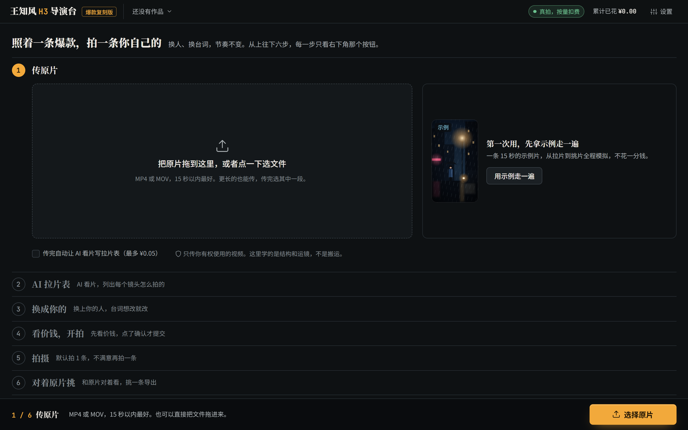
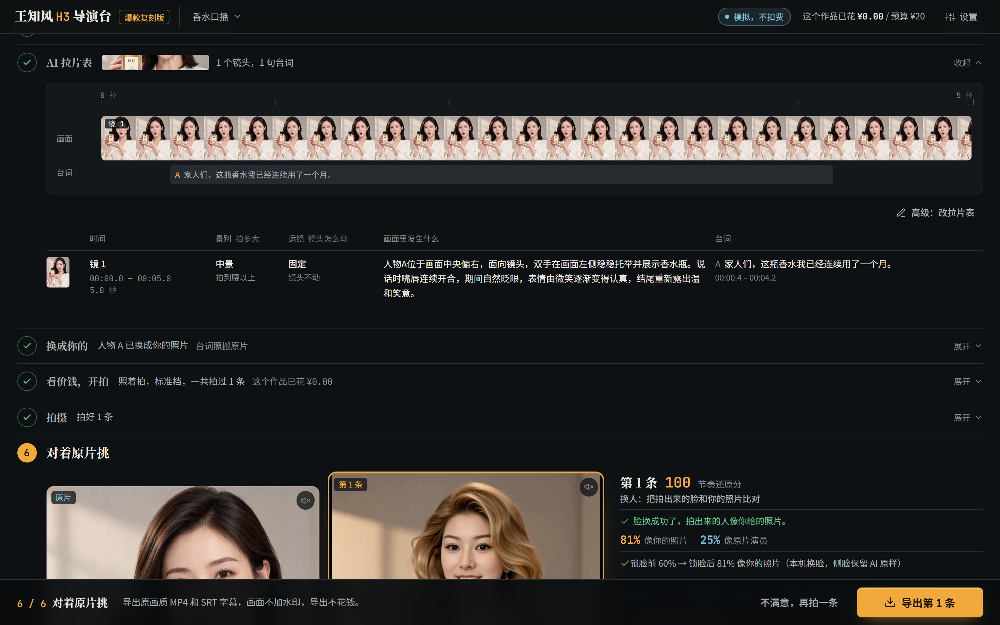
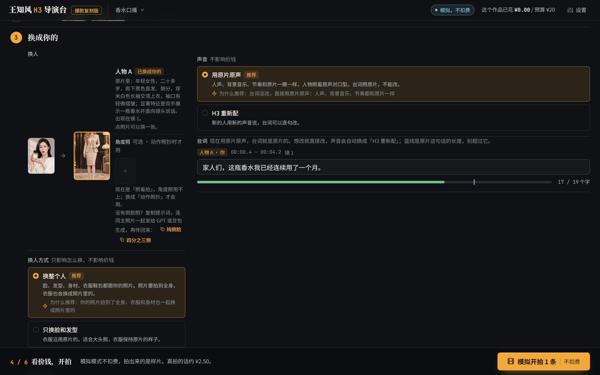

<div align="center">

# ShotForShot · 爆款复刻

**一条爆款短视频 + 一张你的照片 → 逐镜重拍成你的版本**

王知风 H3 导演台 · 爆款复刻版 —— 基于 MiniMax H3 视频模型的 Windows 本机工具

[](LICENSE)


[English](README_EN.md) · [工作原理](docs/工作原理.md) · [更新记录](CHANGELOG.md)


<sub>截图为模拟模式下的界面演示；示例里的人物都是 AI 生成的。</sub>

</div>

## 这是什么

把一条 15 秒以内的爆款短视频拖进来，放一张你的人物照片，软件会：

1. **AI 拉片**：本机切镜头、识别每句台词的起止时间，再让 AI 看画面，写出每个镜头的景别、运镜、动作，做成一张可以改的拉片表；
2. **换成你的**：把原片里的人换成你照片里的人，台词想改就改（按原句时长限字数，节奏不乱）；
3. **先报价再拍**：用 MiniMax H3 官方接口重拍，拍之前把价钱算好给你看，你点确认才提交；
4. **对着原片挑**：成片和原片并排同步播放，自动打「节奏还原分」，挑一条导出 MP4 + SRT 字幕。

不用写提示词，不用连 ComfyUI 节点，双击 `启动导演台.bat` 就能用。

## 功能亮点

| | |
|---|---|
| 🎬 **逐镜复刻** | 原片的切点由本机程序量出来，不靠 AI 猜。一条 15 秒样片实测：成片 3 个切点和原片差 0.13 / 0.63 / 0.46 秒，4 句台词全对（单条样例，不是平均值） |
| ✍️ **换人还能改台词** | 新台词按原句时长限字数，H3 原生出声；也可以直接用原片原声 |
| 🧑 **锁脸** | 拍完在本机用换脸引擎再换一遍脸，不花钱。实测 7 条：和你照片的相似度从 0.49～0.64 提到 0.65～0.81（脸在画面里越小，提升越少） |
| 🧽 **新片不带原片水印** | 「照着拍」不提交原片视频；「动作照抄」交给 H3 的参考片会先在本机抹掉平台水印 |
| 💰 **花钱透明** | 拍摄前报价、每个作品有预算上限、账本记下每一笔；拉片和台词核对几分钱，按实际用量记账；示例和模拟模式全程免费 |
| 🤖 **可选 GPT 看片** | 有 OpenAI 赠送额度的话，填上密钥让 GPT 写拉片表，人物细节和水印框更准；连不上自动退回 MiniMax |
| 🔒 **本机运行** | 程序、作品、密钥都在你电脑上；网页服务只绑 127.0.0.1；没有遥测 |

## 界面

| 1. 传原片 | 2. AI 拉片表 |
|---|---|
|  |  |
| **3. 换成你的** | **6. 对着原片挑** |
|  |  |

## 两种拍法

软件看完原片会自动推荐，也可以自己改：

| | 照着拍（默认） | 动作照抄 |
|---|---|---|
| 交给 H3 拍摄的 | 拉片表写成的分镜剧本 + 你的照片（+ 原片里不换的人的脸部截图），**不提交原片视频** | 原片视频（原演员的脸先在本机涂掉，一处都没涂上会拦下、不上传）+ 你的照片 |
| 效果 | 人最像你；构图、运镜按剧本重拍，不是逐帧一样 | 动作、构图很接近原片 |
| 适合 | 有对白、有近景的短剧、口播 | 跳舞、全身动作、没有台词的片子 |
| 15 秒约 | ¥7.5 | ¥15（原片也按秒收费） |

## 快速开始

### 普通用户：下载安装包

1. 下载安装包：[夸克网盘「爆款视频复刻」](https://pan.quark.cn/s/b4732e377421)，解压到任意文件夹（中文路径、带空格都行）；
2. 双击 `启动导演台.bat`，网页会自动打开；
3. 第一次先点「用示例走一遍」，全程模拟，不花钱；
4. 要真拍：到 [MiniMax 开放平台](https://platform.minimax.cn) 充值「余额」（不要买 Token Plan 套餐，套餐密钥拍不了 H3），新建接口密钥，粘到导演台右上角「设置」里。

安装包自带 Python 运行环境、ffmpeg、人脸模型、换脸引擎和示例，不用另装任何东西。详细说明见 [使用说明.txt](使用说明.txt)。

### 开发者：从源码运行

需要 Python 3.12（Windows）。

```powershell
git clone https://github.com/wwzhifeng/ShotForShot.git
cd ShotForShot
py -3.12 -m venv .venv
.venv\Scripts\pip install -r requirements.txt
```

再从安装包里把这几样拷到仓库里同样的位置（它们太大或许可不同，不放进仓库）：

| 拷什么 | 放到 | 没有会怎样 |
|---|---|---|
| `runtime\ffmpeg\bin\ffmpeg.exe`、`ffprobe.exe` | 同名位置（或设环境变量 `H3DT_FFMPEG_DIR`） | 必需 |
| `程序\models\*.onnx`（人脸检测、分割、识别） | 同名位置 | 必需（传照片查脸、动作照抄涂脸、像不像打分都要用） |
| `换脸引擎\` | 仓库根目录 | 锁脸自动关闭，其余照常 |
| `示例\` | 仓库根目录 | 点不了「用示例走一遍」，其余照常 |

然后：

```powershell
.venv\Scripts\python -X utf8 程序\launcher.py
```

## 费用（MiniMax 官方价）

| 项目 | 价格 |
|---|---|
| 照着拍（H3 768P） | ¥0.5 / 秒，15 秒约 ¥7.5；可以先试前 5 秒约 ¥2.5 |
| 动作照抄（H3 768P） | ¥1 / 秒（原片参考也按秒收），15 秒约 ¥15 |
| 高清 2K | 贵六成 |
| 拉片（识别台词 + AI 看片） | 一条约几分钱；选 GPT 看片时，看片用你自己的 OpenAI 额度 |
| 台词核对（重新配音、有台词时自动做） | 语音识别 ¥2.5 / 小时，一条约 1 分钱 |
| 锁脸、对比、导出 | 本机完成，不花钱 |

拍摄前的报价是按官方价算的估算，实扣以 MiniMax 返回为准，账本里记的是实扣。拍一条 15 秒一般要 6～13 分钟，可以关掉网页，回来会接着显示。

## 已知限制

我们把做不好的地方写在这里：

- **最长 15 秒**：H3 一次最多拍 15 秒，更长的原片要选一段；30 秒（拆两段拼接）还在测试；
- **纯侧脸**：放了角度照，转头、四分之三侧能跟上，纯侧脸还转不过去；
- **两人同框的远景**：动作照抄涂脸时可能涂错人；
- **动作照抄偶尔会把原片字幕学进画面**：介意就换照着拍；
- **照着拍是重拍**：构图、道具会和原片有差别，原片里没换的人会变成「长得像」的新演员；
- 目前只在 Windows 11 + NVIDIA 显卡上完整实测过，Windows 10 和高 DPI 屏幕还没测；没有 N 卡也能用，锁脸改走 CPU，会慢一些。

## 目录结构

```
ShotForShot/
├─ 启动导演台.bat        一键启动（纯 ASCII，路径自动推导）
├─ 使用说明.txt
├─ 程序/
│  ├─ launcher.py         启动器：检查、起本机服务、打开网页
│  ├─ faceswap_boot.py    换脸引擎的启动引导
│  ├─ h3dt/               后端
│  │  ├─ analyze.py       AI 拉片：切镜、识别台词、看片、合成拉片表
│  │  ├─ prompt.py        拉片表 → H3 分镜提示词
│  │  ├─ service.py       作品流程：报价、拍摄队列、对账、收尾
│  │  ├─ minimax.py       MiniMax 官方接口
│  │  ├─ gpt.py           可选：OpenAI 看片
│  │  ├─ faces.py         人脸检测、分割、识别（涂脸、像不像）
│  │  ├─ faceswap.py      锁脸
│  │  ├─ scoring.py       节奏还原分：切点、音轨同步、像不像
│  │  └─ …
│  └─ web/                前端（原生 JS，无构建、无外网依赖）
└─ docs/
```

运行时会在根目录生成 `设置\`（密钥）、`作品\`、`缓存\`、`日志\`，都不会进仓库。

## 隐私与安全

**留在你电脑上的**：程序、你的作品、密钥（存在 `设置\` 文件夹，不进作品、不进日志，界面只显示后 4 位）。

**会发出去的**，只在你用到对应步骤时：

| 发给 | 什么时候 | 发什么 |
|---|---|---|
| MiniMax | 拉片 | 选好的那段原片（语音识别、AI 看片） |
| MiniMax | 拍摄 | 你的照片（含角度照）、场景图、原片里不换的人的脸部截图；动作照抄时还有涂过脸的参考片；用原声时还有原声片段 |
| MiniMax | 台词核对 | 拍出来那条的声音 |
| OpenAI | 拉片，只在选了 GPT 看片时 | 原片按每秒 2 帧抽的画面、识别出的台词 |

网页服务只监听 `127.0.0.1`，每个接口都要校验启动时生成的令牌和请求来源，别的网页没法替你花钱。没有遥测，不检查更新。

## 使用须知

- 请只用你有权使用的视频和照片；换成别人的脸之前，先取得本人同意；
- 成片不带 AI 生成标识水印，发布时请按平台要求自行声明「AI 生成内容」；
- 不得用于冒充他人、诈骗、色情或其他违法用途。

## 许可证

Copyright (C) 2026 王知风

- 本仓库的源代码按 [GNU GPL v3](LICENSE) 发布。安装包里的程序由本仓库对应版本的源码编译而来。
- 安装包附带的第三方组件各有各的许可，其中锁脸用到的部分模型只允许非商业或研究用途，所以安装包整体仅供个人非商业使用。详见 [THIRD_PARTY_NOTICES.md](THIRD_PARTY_NOTICES.md)。
- 本项目不是 MiniMax 官方产品。MiniMax、H3 是 MiniMax 的产品和模型名称，这里只用来说明本工具调用的是哪家的接口。

## 作者

**王知风** · 官网 [huigui.ai](https://huigui.ai) · AI 工具交流 QQ 群 957732664

有问题请提 [Issue](https://github.com/wwzhifeng/ShotForShot/issues)。附上「日志」文件夹会更快定位；日志里没有密钥，但有本机路径和台词，介意请先打码。
