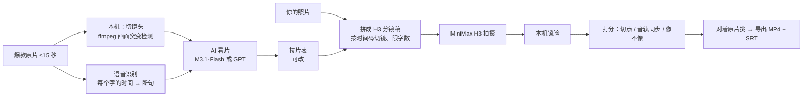

# 工作原理

## 1. AI 拉片：不只是「反推提示词」

让 AI 看一段视频写描述，技术上和「反推提示词」一样，都是多模态大模型。区别在前后多做的这些事：

| | 普通反推 | 拉片 |
|---|---|---|
| 哪里换镜头 | AI 估，或者不分 | 本机 ffmpeg 按画面突变量出来 |
| 台词 | 没有，或大概一句 | 语音识别给每个字的时间，程序自己断句 |
| 谁说的 | 没有 | AI 看谁在张嘴；分清对白、旁白、背景歌词 |
| 格式 | 一段散文 | 每镜一行：景别、运镜（类型 / 幅度 / 速度）、谁在画面里、做什么；人物编号全片统一，主角固定是 A |
| 字幕水印 | 不管 | 标出位置：动作照抄时把水印抹掉；字幕保留（实测抹掉字幕留下的模糊带，反而让 H3 在新片里烧出字幕） |
| 之后 | 你自己拿去用 | 程序拼成 H3 能直接拍的分镜稿 |

AI 看片默认用 MiniMax M3.1-Flash，几分钱一条、国内直连。填了 OpenAI 密钥可以改用 GPT：GPT 收不了整段视频，程序按每秒 2 帧抽图、每张标上时间发过去，要它填同一份拉片表。11-25 用 7 条原片对比：两边的镜头数、台词归属、字幕判断一样；GPT 在人物细节（眼镜、发型、配饰）、景别和水印框上更准。

## 2. 拼成 H3 分镜稿

- 按拉片表的时间码写成 `[Shot N] At …` 的分镜格式。在自己生成的原片上测过，H3 按这个格式切镜，误差不超过 0.2 秒；一条 15 秒爆款样片重拍后，3 个切点和原片差 0.13 / 0.63 / 0.46 秒。
- 「人物 A」指向你上传的照片；提示词里用「参考图里的人」指代，不写真实人名。
- 改写的台词按原句时长限字数，原片语速作参照，超了界面标红。
- 原片里不换的人，「照着拍」时截一张他的脸当参考图，尽量保持长相。

## 3. 两种拍法怎么选

实测发现：只要把原片视频交给 H3，原片里脸清楚的人就很难换掉，H3 会把脸学回原演员。所以：

- **照着拍**：不传原片，只给分镜剧本 + 照片。有对白、有近景、有特写时默认用它。
- **动作照抄**：传原片，但先在本机用人脸分割把原演员的脸和头发涂成实心块，H3 才学不回去；一处都没涂上时拦下、不上传。全是全景、远景、没有台词时默认用它。

## 4. 锁脸

H3 拍完，本机用换脸引擎按你的照片把脸再换一遍。实测 7 条：和照片的相似度从 0.49～0.64 提到 0.65～0.81，脸在画面里越小提升越少。侧脸、转头很大的画面保留 AI 原样（换脸引擎侧脸效果不好），原片里不换的人不会被换掉。挑片时可以看、可以导出换脸前的原版。

## 5. 打分

每条成片和原片比三样，合成「节奏还原分」：

- **切点**：成片和原片换镜头的时间差；
- **音轨同步**：用原声时，H3 出的那版音轨和原声的节奏、时差对不对得上（比的是声音，嘴型以并排播放为准）；重新配音时，用语音识别核对台词说没说对；
- **像不像**：成片里的脸和你的照片、和原片演员各有多像。

默认选最高分的那条，你也可以自己挑。
